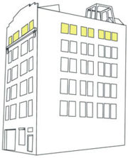

This page purports to be an electronic history of that strange concrete box at 79 Lorimer Street, 6th Floor, occasionally referred to as "the slab."

## History

John and Arthur, then living near Journal Square in Jersey City, NJ, discovered a Craigslist posting in spring 2002. Concurrently, Seth and Dan decide to move north as well (Seth from DC, Dan from Union City, NJ). One fateful day at that same Jersey City residence, Arthur and Seth had a conversation that first introduced the idea of combining these two duos into a fearsome foursome able to take over the massive lease posted on Craigslist. Dimitri Hamlin, then a recent graduate, then joined the fray.

When we first arrived at 79 Lorimer, the 4000 square feet was a giant empty room with the bathroom and kitchen sitting uninstalled in the middle of the floor amongst concrete rubble and broken glass. With the insane leadership of Jon Esposito (who gave us approximately 300 hours of work for free because it was "a cool project," regardless of the fact that he was also working full time as an EMT *and* going to school), we were able to get walls up in three weeks. The design was organically derived from the fact that two huge industrial space heaters hung down far enough that we had to build around them (which resulted in the empty space being roughly the shape of an hourglass) and was generally designed to maximize common space. As soon as the walls were up, we threw plywood on the roof of the structure with the intention of screwing them down later. To my knowledge, six years later this still has not been done.

Many people helped with the building process, including but not limited to: Chris Menone, Phil Blodgett, Ben West (emotional support), Ryan Fitzsimmons, and Jason Park. Dimitri also sometimes helped.

The original paint job was supposed to reflect the original colors of the loft - the red brick and what remained of the muted cream paint. This was scrapped for John and Becca's wedding, when the walls were painted white.

A swing originally hung from the truss on the roof, and a platform was built on top by a fifth floor resident who had originally planned to live there after he moved out of the fifth floor. Both of these have now been eliminated.

Each winter there has been a winterization attempt at 79 Lorimer, and each year this has failed. Generally speaking, when you come in from the winter cold wearing your winter clothes, do not take them off until you go to bed. The first winter we used the industrial space heaters to some success, until we got the 3-month, \$6000 bill. Ever since, space heaters have dominated the wintertime, causing the loft to resemble a college dorm in the winter, with everyone camping out in their own rooms.

In the summertime, there is perhaps no better roof in all of New York City.

TODO: finish writing this John 15:04, 21 April 2007 (PDT)

## Residents

- Founders (June 2002)
  - John Berry
  - Seth Fleischauer
  - Dan Huron
  - Dimitri Hamlin
  - Arthur Purvis

- Phase 1A (July 2002 - August 2002)
  - Christopher Menone moves in to what was otherwise known as "the gimp room"

- Phase 1 "The Early Years" (September 2002 - June 2003)
  - James Platts-Mills replaces Christopher Menone.
  - guest appearances: Kaz Phillips, Ryan Fitzsimmons, Donny Pecano

- Phase 2 "The Menone Era" (June 2003 - September 2004)
  - Christopher Menone replaces James Platts-Mills, who plays a lot of SSX Tricky with Arthur (is reunited with an old love, and moves to Virginia)
  - Lucy the Tarantula moves in with Christopher Menone, but dies of exposure
  - guest appearances: Dave Mason (Jan-Mar 2004 brrr), J. Grant Atkins (Summer '04), new washing machine

- Phase 3 "Lots of Turnover"
  - 3a (??? - ???)
    - Collin Yeo replaces John Berry (John is on the road to marriage)
    - Shannon Moore replaces Christopher Menone (too cold, too far from popular gay nightlife areas)
  - 3b (??? - ???)
    - Ariel Panero replaces Dan Huron (moves to Boston - ha!)
    - Ezra Huleatt replaces Dimitri Hamlin (moves to L.A.)
  - 3c (??? - ???)
    - James Merle Thomas replaces Arthur Purvis (moves to Japan)
    - James VanBlaricum replaces Collin Yeo (moves to New Orleans, joins band with Phil Anselmo)
  - 3d (??? - ???)
    - Josh Steinbauer and Genghis replace Shannon Moore (moves to Manhattan)
    - Lindsay Ballant replaces Ariel Panero (moves back to parents' house)
    - Arthur Purvis and Alexis Berkowitz replace James Merle Thomas (moves to Spain, then California because Spain is "too Spanish")
    - Genghis assumes role of official 79 Lorimer Pet In Residence
    - New stove replaces old stove (moves to dumpster)

- Phase 4 "A New Beginning" (??? 2005 - ??? 2006)
  - Brian Lightbody replaces Seth Fleischauer (moves to northeast Wiliamsburg)
  - Andy Xue replaces James VanBlaricum (moves to northwest Williamsburg)

- Phase 5
  - Landlords finally raise the rent
  - Andy the Yes Man replaces Lindsay Ballant (too cold; desire for "girly" accoutrements like cleanliness and order)
  - David Little replaces Andy the Yes Man (discovers a living option that is free and next to work and has heat)
  - Kat Cooke replaces Ezra Huleatt (moves to Greenpoint)

- Phase 6 "The Musicians" (2008 - ???)
  - Kat Cooke fails to pay rent because she's spending all her cash on "entertainment." She still owes Arthur \$500 after being unceremoniously removed from the gimp room.
  - Peter Pearson and his synthesizers replace Kat Cooke
  - Aaron Scaturro of the 2nd floor achieves honorary resident status on the 6th floor
  - Gloria Kim replaces David Little (schemes to bike across the Andes; cultivates death wish)
  - David Little, having almost died of numerous parasitic infections while attempting to cross South America by bicycle, returns. A new 7th room is built to accommodate him in a corner that previously just held A Bunch Of Useless Junk; this room, having been built with all the advantages of accumulated knowledge, is actually quite insulated and soundproof.

## Notable Events

- Sleepy Party (written up in TimeOut NY as one of the "Top Underground Parties of 2003")
- Burning Man Party (?)
- Quinceanera
- Normal's First Birthday Barbecue
- Normal's Second Birthday Barbecue
- John and Becca's Wedding (Generally accepted as the greatest party in the history of 79 Lorimer)
- New Year's '03, '04, '05
- The Great Elevator Rescue of 2004, Courtesy of Kiersten Greene
- That time I woke up to go to work and went outside my room to find a dude with his pants down getting spanked with a flyswatter by some girl in a nurse's costume, who later asked to join me in the shower.
- The party at which Ben West and Arthur accidentally ate brownies that had been camping in the oven all winter after subway girl tried to make them on the stovetop seven months previously
- The saga that was subway girl
- The movie productions of "Fugue" and the second Yes Men movie happen at the loft
- A very exciting nabe cooking party
- Two octopi are purchased whole, dismembered, and boiled. Photographic evidence exists.
- Former resident Seth meets Becky (who will later become his bride) at the Memorial Day BBQ, 2007
